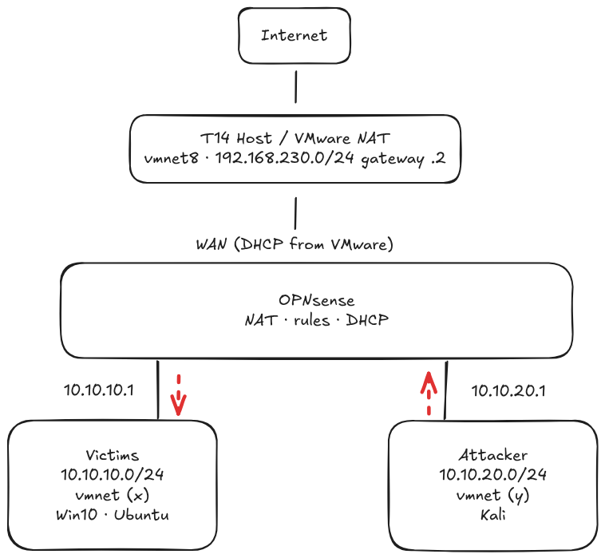

# Lab Network Segmentation

## Goal
A segmented home lab with OPNsense separating a victim zone from an attacker zone, so every attack crosses a firewall that controls and logs it.

## Skills shown
- Network security and segmentation
- Firewalls (rule design, default deny, logging)
- Security infrastructure implementation and maintenance

## Network diagram

## IP plan
| Zone | Subnet | Gateway | Who lives there |
|---|---|---|---|
| WAN | VMware NAT (vmnet8), 192.168.230.0/24 | 192.168.230.2 (VMware) | OPNsense's WAN interface only |
| Victims | 10.10.10.0/24 | 10.10.10.1 (OPNsense) | Win10, Ubuntu |
| Attacker | 10.10.20.0/24 | 10.10.20.1 (OPNsense) | Kali |

### Fixed addresses

| Fixed address | Machine | Why |
|---|---|---|
| 10.10.10.10 | Win10 | Rule 5 names Win10 as the only machine allowed to reach the admin page |

## Intended firewall rules
1. Win10 and Ubuntu may reach the internet on web ports HTTP (80) and HTTPS (443), and OPNsense on DNS (53), so they can browse and get updates
2. Kali may reach the internet on web ports HTTP (80) and HTTPS (443), and OPNsense on DNS (53) so it can browse and get updates.
3. Kali may reach Ubuntu on SSH (22), and Win10 on SMB (445) and RDP (3389) to practice common attacks. Logged.
4. Win10 and Ubuntu may start connections to Kali only on Port 4444 (for simplicity), logged, so phone-home attacks work and are recorded. 
5. Only Win10 may reach OPNsense's admin page (HTTPS 443), to keep it reachable from as few places as possible. Kali should never be able to access it.
6. Default deny with logging.
7. No lab machine may reach my home network (192.168.0.x) or the T14 (192.168.230.1). Logged.

**Rule order:** Rule 7 must sit above rules 1 and 2. Rule 6 is always last.

## Known trade-offs
- The firewall is managed from Win10, a "victim" machine. In production this would be a separate management zone.
- Phone-home port 4444 is used for simplicity. Real attackers often use 443 to blend in.

## Status
Week 0: design complete. Build starts 19 Oct 2026.
